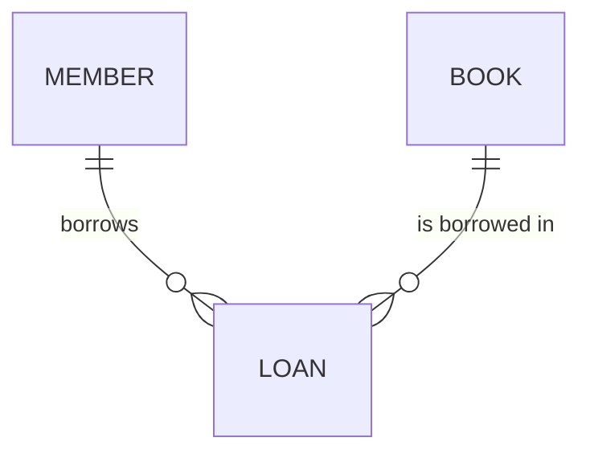

# Entity Model

APP_USER (id, username, password_hash, role, created_at) ships with the project and is an external boundary.

## Entity Relationship Diagram

### BOOK

A work in the catalog, identified by its ISBN, of which the library owns one or more copies.

| Attribute  | Description                                                                 | Data Type | Length/Precision | Validation Rules      |
|------------|-----------------------------------------------------------------------------|-----------|------------------|-----------------------|
| id         | Unique identifier                                                           | Long      | 19               | Primary Key, Sequence |
| title      | Title of the book                                                           | String    | 200              | Not Null              |
| author     | Author or authors of the book, as printed on the cover                      | String    | 200              | Not Null              |
| isbn       | ISBN-10 or ISBN-13 of the book, digits only (an ISBN-10 may end in X)        | String    | 13               | Not Null              |
| copies     | Number of copies the library owns                                           | Integer   | 10               | Not Null, Min: 1, Max: 999 |
| removed_at | Date and time the librarian removed the book from the catalog; empty while it is in the catalog | DateTime  | -                | Optional              |

#### Constraints

- isbn consists of exactly 10 or exactly 13 characters: digits only, except that the last character of a 10-character ISBN may be X.
- No two books that are not removed share the same isbn (isbn is unique among books whose removed_at is empty).
- copies is never lower than the number of active loans of the book.
- A removed book is not shown in the catalog search and cannot be borrowed; its loans stay unchanged.

### MEMBER

A person who borrows books, linked to exactly one user account with the role member.

| Attribute | Description                                        | Data Type | Length/Precision | Validation Rules                           |
|-----------|----------------------------------------------------|-----------|------------------|--------------------------------------------|
| id        | Unique identifier                                  | Long      | 19               | Primary Key, Sequence                      |
| user_id   | User account the member signs in with              | Long      | 19               | Not Null, Unique, Foreign Key (APP_USER.id) |
| name      | Full name of the member                            | String    | 100              | Not Null                                   |
| email     | Email address of the member                        | String    | 254              | Not Null, Unique, Format: Email            |

#### Constraints

- The user account a member links to has the role MEMBER; a user account with the role LIBRARIAN has no member.

### LOAN

The record that a member borrowed one copy of a book, and when it was returned.

| Attribute   | Description                                                      | Data Type | Length/Precision | Validation Rules                  |
|-------------|------------------------------------------------------------------|-----------|------------------|-----------------------------------|
| id          | Unique identifier                                                | Long      | 19               | Primary Key, Sequence             |
| book_id     | Book whose copy was borrowed                                     | Long      | 19               | Not Null, Foreign Key (BOOK.id)   |
| member_id   | Member who borrowed the copy                                     | Long      | 19               | Not Null, Foreign Key (MEMBER.id) |
| borrowed_at | Date and time the member borrowed the copy                       | DateTime  | -                | Not Null                          |
| returned_at | Date and time the member returned the copy; empty while active   | DateTime  | -                | Optional                          |

#### Constraints

- returned_at is not earlier than borrowed_at.
- The number of active loans of a book (returned_at empty) never exceeds the book's copies.
- A loan is started only for a book whose removed_at is empty.
